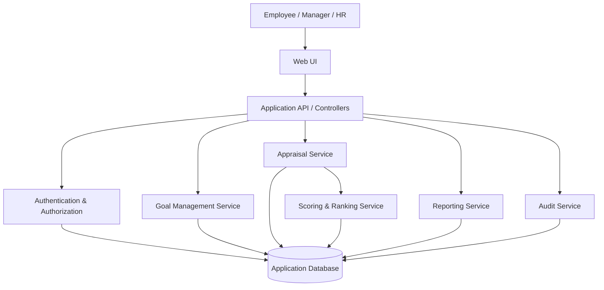
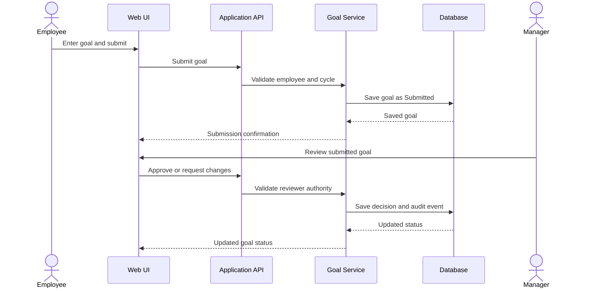
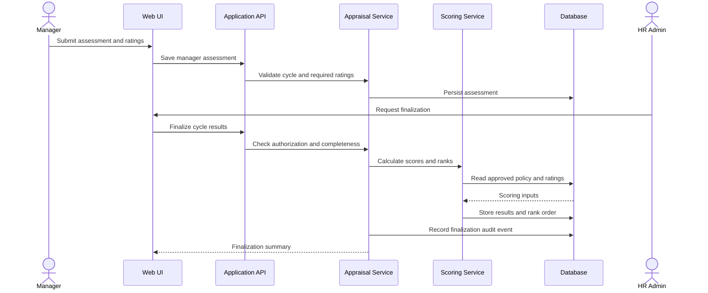

# Software Architecture and Design Specification (SAD)
## Automated Performance Appraisal System

**Version:** 1.0 (Draft for team review)  
**Date:** 28 October 2026  
**Status:** Proposed design — verify against the implementation

## 1. Introduction

### 1.1 Purpose
This document describes a maintainable architecture for the Automated Performance Appraisal System, covering goal management, progress tracking, appraisals, score calculation, ranking, reporting, and auditability.

### 1.2 Scope
The initial design focuses on a role-based web application. It excludes payroll integration, recruitment, and automatic employment decisions.

### 1.3 Audience
Developers, testers, project guide, HR stakeholders, and evaluators.

## 2. Document overview and related documents
- SRS: `SRS.md`
- Test Plan: `Test_Plan.md`
- The final submission should also include rendered UML component/use-case/sequence diagrams and an API specification appropriate to the chosen stack.

## 3. Architecture

### 3.1 Goals and constraints
**Goals:** separation of concerns, secure role-based access, reproducible scoring, auditable changes, understandable workflows, and testability.

**Constraints:** the exact framework and database are not yet confirmed. The architecture below is technology-neutral and should be mapped to the team's selected stack before implementation.

### 3.2 Stakeholders and concerns
- Employees: ease of use, privacy, transparent status.
- Managers: accurate team review and feedback.
- HR: consistent appraisal policy, reporting, audit trail.
- Developers: modularity and testability.
- Evaluators: traceable requirements, test evidence, and working CI/CD.

### 3.3 Chosen architecture pattern and rationale
**Proposed pattern: layered monolithic web application.** A presentation layer, application/service layer, domain rules layer, and persistence layer are sufficient for a student mini-project. This keeps deployment simple while separating business rules. Microservices are not proposed because they add operational complexity without a demonstrated need.

### 3.4 Logical component diagram

### 3.5 Component descriptions
- **Web UI:** role-specific dashboards, goal forms, review screens, appraisal summaries, and reports.
- **Application API/controllers:** validates requests, calls services, maps results to responses.
- **Authentication/authorization:** identifies users and enforces role plus record-level access.
- **Goal management service:** creates goals and handles submission, approval, rejection, and progress updates.
- **Appraisal service:** manages self-assessment, manager review, status transitions, and finalization.
- **Scoring/ranking service:** applies the approved rating scale and weights, computes final scores, handles ties, and excludes ineligible records.
- **Reporting service:** prepares authorized cycle and ranking summaries.
- **Audit service:** records important actions with actor, timestamp, action, and target record.
- **Persistence layer:** stores users, role/manager relationships, cycles, goals, ratings, results, and audit events.

### 3.6 Technology stack and data stores
The implementation stack is **to be confirmed by the team**. Choose one supported frontend/backend/database combination and document exact versions in the final SAD. Do not claim a framework or database is used until it exists in the repository.

### 3.7 Data model (logical)
- **User:** user_id, name, email, role, manager_id, account_status.
- **AppraisalCycle:** cycle_id, name, start_date, end_date, status, policy_version.
- **Goal:** goal_id, employee_id, cycle_id, title, description, target, due_date, weight, status.
- **ProgressUpdate:** update_id, goal_id, progress_value, evidence_note, created_at, created_by.
- **GoalReview:** review_id, goal_id, reviewer_id, decision, comment, reviewed_at.
- **Assessment:** assessment_id, employee_id, cycle_id, assessor_id, assessment_type, status, submitted_at.
- **Rating:** rating_id, assessment_id, criterion_id, rating_value, comment, evidence_note.
- **Criterion:** criterion_id, cycle_id, name, description, weight, rating_min, rating_max.
- **FinalResult:** result_id, employee_id, cycle_id, score, rank, status, finalized_by, finalized_at.
- **AuditEvent:** event_id, actor_id, action, entity_type, entity_id, timestamp, reason.

Foreign keys and uniqueness constraints should prevent duplicate employee/cycle assessments and orphaned records. Sensitive fields should be limited to the minimum necessary.

### 3.8 Scoring and ranking design
The exact formula must be approved before coding. A possible weighted-score model is:

`Final Score = sum(criterion weight × normalized criterion rating) / sum(applicable criterion weights)`

This formula is a proposal only. Define how missing ratings, goal weights, different rating scales, ties, and incomplete appraisals are handled. Ranking must use finalized results from the same cycle and policy version; draft results must not appear in released ranking reports.

### 3.9 Traceability to requirements
- Authentication component: FR-001 and SR-001 to SR-003.
- Goal management: FR-003 to FR-006.
- Appraisal service: FR-007, FR-008, FR-011.
- Scoring/ranking: FR-009 and FR-010.
- Reporting/audit: FR-012 to FR-015 and SR-005.

### 3.10 Risks and mitigations
| Risk | Mitigation |
|---|---|
| Unclear or changing scoring rules | Agree and version the policy before implementation. |
| Unauthorized access to employee data | Server-side role and record-level checks plus negative tests. |
| Inconsistent scores after policy changes | Store policy version and inputs used for finalized results. |
| Duplicate submission or partial finalization | Use transactions/idempotent actions and test retry behaviour. |
| Scope grows beyond sprint time | Deliver goal workflow and one complete appraisal cycle first. |

### 3.11 Security architecture
Threat considerations:
- **Spoofing:** secure authentication and session handling.
- **Tampering:** server-side validation, controlled status transitions, and audit events.
- **Information disclosure:** role/record-level authorization and HTTPS.
- **Repudiation:** timestamped audit trail for sensitive actions.
- **Denial of service:** sensible request limits and input-size validation where applicable.
- **Elevation of privilege:** deny-by-default authorization and tests for role boundaries.

## 4. Design

### 4.1 Design overview
Use explicit state transitions for the lifecycle:
- Goal: Draft → Submitted → Approved / Changes Requested / Rejected.
- Appraisal: Open → Self-assessment Submitted → Manager Review → HR Finalization → Released.
- Finalized or released records should not be silently edited. Any authorized reopening must require a reason and create an audit event.

### 4.2 Sequence diagram 1 — goal submission and approval

### 4.3 Sequence diagram 2 — appraisal finalization and ranking

### 4.4 API design (illustrative; paths must match implementation)

**Endpoint A — submit a goal**
- Method: POST
- Proposed path: `/api/goals`
- Request fields: title, description, target, dueDate, cycleId, weight.
- Success: `201 Created` with goal ID and status.
- Validation errors: `400 Bad Request`; unauthenticated: `401 Unauthorized`; forbidden: `403 Forbidden`.
- Security: employee identity comes from the authenticated session/token, not a trusted client-supplied employee ID.

**Endpoint B — finalize an appraisal cycle**
- Method: POST
- Proposed path: `/api/appraisal-cycles/{cycleId}/finalize`
- Request fields: optional reason or confirmation token, as selected by implementation.
- Success: summary of finalized result count and cycle status.
- Errors: `401` unauthenticated, `403` unauthorized, `409 Conflict` for incomplete/already-finalized cycle, `422 Unprocessable Entity` for invalid state.
- Security: HR authorization, completeness checks, transaction-safe writes, and audit event are mandatory.

### 4.5 Error handling, logging, and monitoring
Return consistent error structures with a safe user-facing message and correlation/request ID where supported. Never log passwords, authentication tokens, or unnecessary appraisal content. Record relevant business audit events separately from diagnostic logs.

### 4.6 UX design
Provide clear progress/status labels, explain rating scales, show validation beside the relevant field, confirm irreversible actions, and distinguish draft scores from released results. Ensure tables and forms are usable by keyboard and have accessible labels.

### 4.7 Open issues and next steps
1. Confirm scoring criteria, weights, rating scale, tie handling, and policy owner.
2. Select and record the technology stack.
3. Implement authentication and role checks before adding appraisal data.
4. Implement goal workflow, then one end-to-end appraisal cycle.
5. Add actual rendered UML diagrams and align endpoint examples with the code.
6. Add tests and an application CI/CD workflow after the stack and build commands are known.

## 5. Appendices
**Glossary:** KPI, appraisal cycle, RBAC, API, audit event.  
**Tools (proposed):** a UML editor such as PlantUML or Mermaid, a version-controlled API specification, and the team's chosen test framework.
